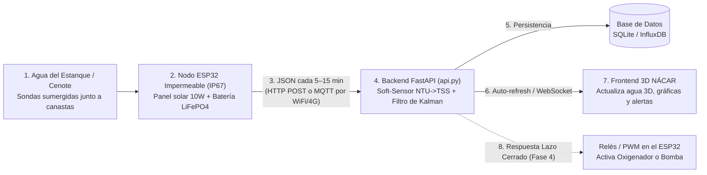

# Reporte de Implementación y Conexión de Sensores IoT — Gemelo Digital NÁCAR

> **Propósito:** Documentar la arquitectura exacta de conexión física (hardware), protocolo de transmisión, recepción en el backend (`digital twin/methods`) y actualización en vivo del frontend (`digital twin/frontend`) para cuando se instalen las sondas en el estanque o cenote piloto, así como las mejoras de precisión matemática y calibración de la Fase 2.

---

## 1. Estado Actual: Cómo Opera Hoy el Gemelo Digital (Sin Quitar Nada al Conectar Sensores)

1. **Convivencia de Modos (Simulador + Tiempo Real):**
   - Al conectar los sensores físicos **no se elimina ninguna ecuación, panel ni control** de la versión actual.
   - El **Modo Simulador / Diseño ("¿Qué pasaría si…?")** se conserva íntegro para dimensionar nuevos cuerpos de agua antes de instalar canastas o simular eventos extremos (olas de calor, descargas contaminantes).
   - El **Modo Monitoreo en Vivo** simplemente alimenta automáticamente las variables de `"Agua Inicial"` ($T, \text{pH}, S_O, \text{Turbidez NTU}, S_{NH}$) desde las sondas sumergidas en lugar de moverlas manualmente con los sliders.

2. **Infraestructura de Software que YA Está Construida en el Proyecto:**
   - **Entrada tipada (`WaterInitialAndIoTInput` en `methods/models.py`):** Acepta tanto sólidos suspendidos (`tss_mg_L`) como lecturas crudas del sensor óptico de turbidez (`turbidity_ntu`).
   - **Soft-Sensor Kárstico (`SoftSensorKarstMapper` en `methods/engine.py`):** Convierte automáticamente los `NTU` medidos por el sensor a `TSS [mg/L]` (`TSS = NTU × 1.45`) y completa el calcio, alcalinidad y radiación solar con la línea base de Yucatán cuando no hay electrodos dedicados para esos iones.
   - **Filtro de Kalman (`assimilate_iot_reading` en `methods/engine.py` y endpoint `POST /iot-assimilation` en `methods/api.py`):** Fusiona el estado predicho por las ecuaciones diferenciales con la lectura recién llegada del sensor ($\hat{x} = x_{\text{pred}} + K(x_{\text{obs}} - x_{\text{pred}})$) y proyecta hacia adelante cuántas horas restan para abatir *E. coli* y turbidez.
   - **Slot de Controlador Electrónico (`ActuatorControllerSlot` en `methods/controller_slot.py`):** Calcula en tiempo real los porcentajes `% PWM` para oxigenador, bomba de recirculación, enfriamiento y dosificación algal.

---

## 2. Flujo Completo de Conexión Física y Digital (Paso a Paso)



### Paso 1: Hardware en el Agua y Cableado al Microcontrolador (ESP32)

En la orilla del estanque o en una boya flotante se instala un gabinete estanco **IP67** con una placa **ESP32** (con WiFi integrado, o **ESP32 + módulo celular 4G SIM7600 / LoRa** si el cenote no cuenta con red WiFi cercana), alimentada por una batería `LiFePO4 12V/5V` y un panel solar de `10W`.

| Sensor Sumergible | Qué Mide | Conexión Eléctrica al ESP32 | Función dentro del Gemelo Digital |
| :--- | :--- | :--- | :--- |
| **`DS18B20` Impermeable** (Acero inoxidable) | Temperatura del agua ($T$, $^\circ\text{C}$) | • Rojo $\to$ `3.3V`<br>• Negro $\to$ `GND`<br>• Amarillo $\to$ `GPIO 4` (1-Wire con resistencia pull-up $4.7\text{ k}\Omega$) | Modula la tasa de bombeo branquial $f_T(T)$, respiración $OCR$, ventana reproductiva $f_{T,\text{rep}}$ y saturación de oxígeno $S_{O,\text{sat}}(T)$. |
| **Sonda Óptica de Turbidez** (`DFRobot Gravity SEN0189` o industrial RS485) | Turbidez nefelométrica ($\text{NTU}$) | • Placa adaptadora en caja seca $\to$ `5V` y `GND`<br>• Salida analógica $\to$ `GPIO 34 (ADC1)` (o `RS485 Modbus`) | El **Soft-Sensor** convierte $\text{NTU} \to TSS\text{ [mg/L]}$, actualiza la saturación branquial $f_{TSS}$, las pseudoheces $PsR$ y estima indirectamente la remoción de bacterias *E. coli*. |
| **Electrodo de pH Industrial** (`Atlas Scientific EZO-pH` o `DFRobot Gravity V2` con aislamiento) | Potencial de hidrógeno ($\text{pH}$) | • Conector `BNC` al módulo aislado<br>• Comunicación `I2C` (`SDA -> GPIO 21`, `SCL -> GPIO 22`) | Calcula el Índice de Saturación de Calcita ($SI_c = \text{pH} - \text{pH}_{\text{sat}}$) para la coprecipitación kárstica de fósforo ($\text{CaCO}_3\text{-P}$) y toxicidad de amoniaco. |
| **Sonda de Oxígeno Disuelto (OD)** (Galvánica u óptica luminiscente con aislamiento) | Oxígeno disuelto ($S_O$, $\text{mg/L}$) | • Conector `BNC` / `UART` o `I2C` (`GPIO 21 / 22`) con aislamiento galvánico | Alimenta $f_{DO}(S_O)$ de las almejas, nitrificación bacteriana CWM1, seguridad del marsupio branquial y la consigna del **Oxigenador PWM**. |
| *(Opcional)* **Sonda de Conductividad / Amonio ISE** | Conductividad ($\mu\text{S/cm}$) o Amonio ($S_{NH}$) | • `I2C` o `RS485 Modbus` | Corrige en directo el balance de nitrógeno entre la excreción de las almejas y la absorción de las plantas. |

> **Nota sobre bacterias (*E. coli*):** No existe un sensor electrónico económico de inmersión que cuente UFC de *E. coli* cada 5 minutos. El Gemelo Digital resuelve esto actuando como un **sensor virtual microbiológico**: al medir en tiempo real cuánta turbidez ($\text{NTU}$) están retirando las almejas y cuál es la temperatura/luz solar, calcula cuántas bacterias quedan en el agua y se recalibra cada vez que se ingresa un conteo de laboratorio.

---

### Paso 2: Firmware del ESP32 (Envío del Paquete JSON cada 10 Minutos)

El ESP32 permanece en modo de bajo consumo (*Deep Sleep*) y despierta cada 5 a 15 minutos durante unos segundos para leer las sondas y enviar un `HTTP POST` (o mensaje `MQTT`) al backend:

```cpp
#include <WiFi.h>
#include <HTTPClient.h>

const char* WIFI_SSID = "RED_ESTANQUE_NACAR";
const char* WIFI_PASS = "PASSWORD";
const char* API_URL   = "http://IP_DEL_SERVIDOR:8000/iot-ingest";

void enviarLecturaAlGemelo(float tempC, float phVal, float odMgL, float turbNtu) {
  if (WiFi.status() != WL_CONNECTED) return;

  HTTPClient http;
  http.begin(API_URL);
  http.addHeader("Content-Type", "application/json");
  http.addHeader("X-Station-Key", "nacar_yucatan_01");

  String payload = "{"
    "\"station_id\":\"estanque_piloto_01\","
    "\"temp_c\":" + String(tempC, 2) + ","
    "\"ph\":" + String(phVal, 2) + ","
    "\"dissolved_oxygen_mg_L\":" + String(odMgL, 2) + ","
    "\"turbidity_ntu\":" + String(turbNtu, 2) +
  "}";

  int httpCode = http.POST(payload);
  if (httpCode == 200) {
    String respuesta = http.getString();
    // La respuesta incluye controller_slot: {"pwm_aerator_pct": 65.0, ...}
    // Con esto el ESP32 puede encender relevadores o bombas PWM en lazo cerrado.
  }
  http.end();
}
```

---

### Paso 3: Recepción en el Backend (`api.py`) y Actualización del Frontend

1. **Almacenamiento ligero de series de tiempo:**
   - Al recibir el JSON en `/iot-ingest`, `api.py` guarda la lectura con su marca de tiempo (`timestamp`) en una base de datos (**SQLite** local en un archivo `telemetry.db` para instalaciones simples, o **InfluxDB** en la nube).
2. **Asimilación por Filtro de Kalman:**
   - `api.py` toma el estado que el modelo había pronosticado para ese instante (`predicted_state`), lo combina con `sensor_reading` usando `engine.assimilate_iot_reading(...)` y genera la nueva curva proyectada para las próximas 72 horas.
3. **Refresco en vivo de la interfaz 3D:**
   - El frontend consulta `GET /latest-state` (o recibe el evento por `WebSocket`) y actualiza automáticamente el color del agua 3D, las curvas y las alertas sin intervención humana.

---

## 3. Hoja de Ruta para Maximizar la Precisión Matemática del Gemelo

1. **Ciclo Solar Día–Noche Horario ($I_{\text{PAR}}(t)$, $T(t)$ y $\text{pH}(t)$):** Incorporar la variación diurna/nocturna para reflejar la pausa fotosintética de las plantas durante la noche y su efecto en el oxígeno y la calcita.
2. **Techo Alométrico en Almejas Gigantes ($L > 90\text{ mm}$):** Suavizar la curva de bombeo en ejemplares senescentes de gran talla según lo observado en los bioensayos de Navinta Huashuayo (2019).
3. **Especiación $\text{NH}_3 / \text{NH}_4^+$ dependiente de pH y Temperatura:** Separar la fracción de amoniaco libre no ionizado para mayor precisión en aguas alcalinas cálidas.
4. **Bandas de Incertidumbre (Monte Carlo) y Calibración Inversa (`/calibrate`):** Mostrar intervalos de confianza y ajustar automáticamente los 5 parámetros más sensibles (`a_CR`, `f_XA_active`, `alpha_hidr_N`, `O:N`, `mu_SG_N`) a partir de pruebas de 24 horas en tanques de 30 litros.
